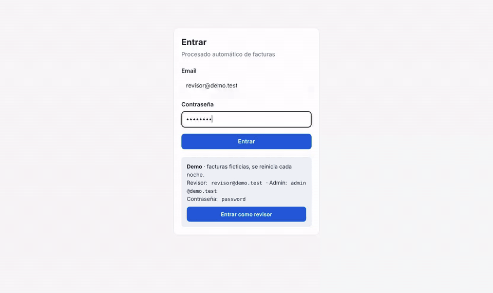
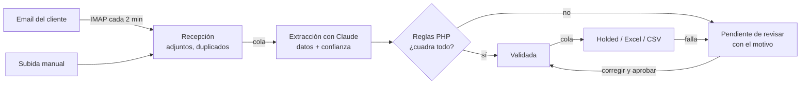
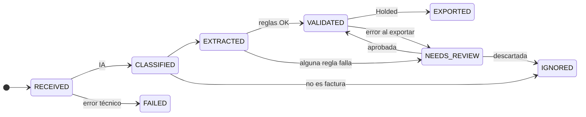
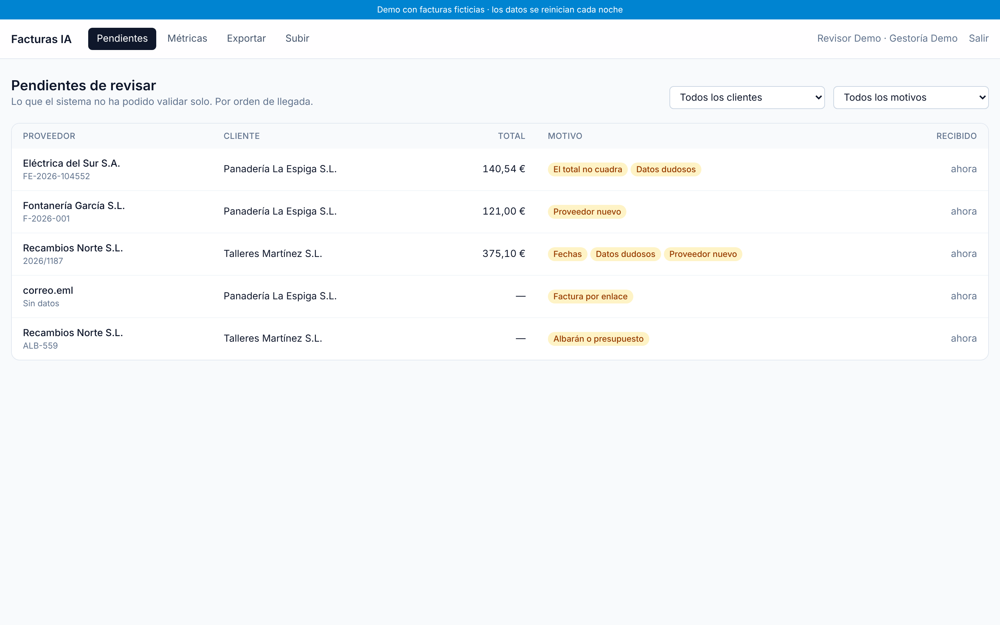
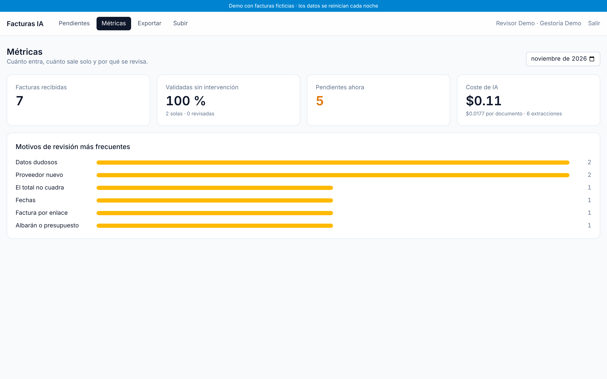
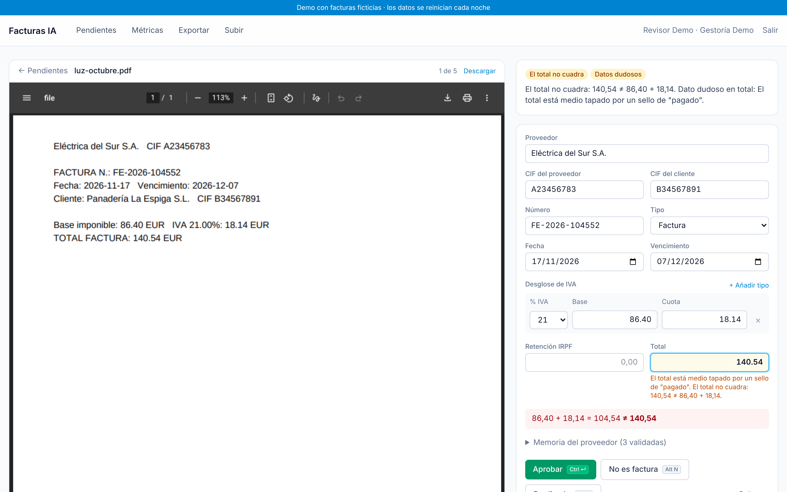
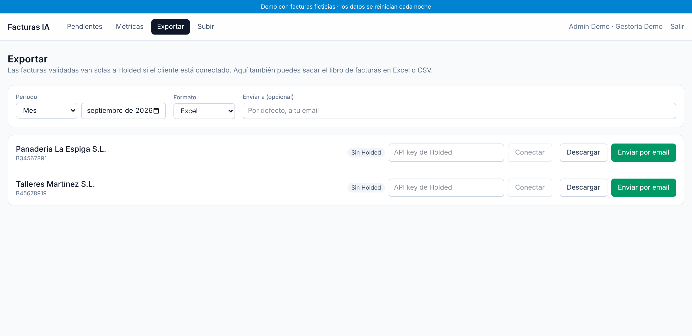
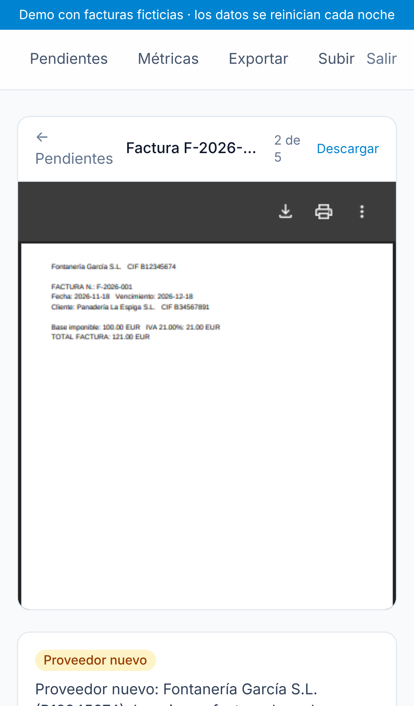

# Facturas IA

**Procesado automático de facturas con IA para gestorías y pymes españolas.**
Las facturas llegan por email, la IA extrae los datos, reglas deterministas
comprueban que cuadran y se exportan solas al programa contable. Una persona
solo entra cuando algo no cuadra.

[](https://github.com/pedropancorbo14/AI-Invoice-Automation-Platform/actions/workflows/ci.yml)



## El problema

Una gestoría recibe cientos de facturas al mes de sus clientes: PDFs, fotos de
tickets, escaneos torcidos, enlaces de descarga... y alguien las teclea una a
una en el programa contable. Los OCR tradicionales fallan con la variedad de
formatos y, cuando aciertan, nadie sabe *cuándo* han fallado.

## La solución: gestión por excepción

1. **Entra sola.** Cada cliente tiene su dirección (`facturas+<token>@…`) y
   reenvía sus facturas con una regla de Gmail u Outlook.
2. **La IA extrae.** Claude devuelve los datos con **confianza por campo**.
3. **Laravel decide.** Reglas en PHP comprueban la aritmética, los CIF, los
   tipos de IVA, las fechas, los duplicados y los proveedores nuevos.
4. **Sale sola.** Lo que cuadra se exporta a Holded (o a Excel/CSV) sin que
   nadie pulse un botón.
5. **La persona, solo para lo dudoso.** Una bandeja con el motivo de cada
   pendiente; revisar y aprobar lleva unos segundos.





## Capturas

| Pendientes de revisar | Métricas del mes |
|---|---|
|  |  |

| Revisión (documento y datos) | Exportar y conectar Holded | Móvil |
|---|---|---|
|  |  |  |

## Decisiones técnicas

- **La IA extrae, Laravel decide.** El modelo nunca valida ni exporta: devuelve
  datos y confianza. Las decisiones son reglas deterministas en PHP, con un
  motivo legible ("El total no cuadra: 121,00 ≠ 100,00 + 20,00") y tests por
  regla. Así un error del modelo no pasa sin que nadie lo vea.
- **Medir antes de creer.** `invoices:eval` pasa un dataset anotado y da la
  precisión por campo, el coste y el tiempo por factura, y cuántas facturas con
  datos mal *pasarían solas* (falsos aprobados, que tienen que ser 0).
- **Lo más barato que funcione.** Si el PDF tiene capa de texto se manda el
  texto; si es un escaneo, el PDF; las fotos se reducen. Clasificar y extraer
  en una sola llamada. Salida estructurada con JSON schema: nada de parsear
  texto libre.
- **Importes en céntimos.** Se guardan como texto con 2 decimales y se suman en
  enteros, en PHP y en el navegador. Nunca con floats.
- **Multi-tenant en dos capas.** Global scope por cuenta (un documento ajeno da
  404) y policies en cada controlador. Un test comprueba que ninguna ruta
  autenticada se queda sin aislamiento.
- **Idempotente de punta a punta.** Mismo correo (Message-ID), mismo fichero
  (SHA-256), misma factura con otro fichero (CIF + número + total) y misma
  exportación (`document_exports`): reintentar nunca duplica.
- **Auditoría inmutable.** Cada cambio de estado y cada corrección humana
  (campo, antes, después, quién) se guarda y no se puede editar.
- **Proveedores intercambiables.** `LLMProvider` para el modelo y
  `ExportTarget` para los destinos: cambiar de modelo o añadir otro programa
  contable no toca el resto.
- **Tests sin red.** Ningún test llama a la API de Claude ni a Holded: se
  simulan a nivel HTTP para comprobar el JSON exacto que sale.

## Resultados

> ⏳ Pendiente: la evaluación con un dataset real de 50-100 facturas
> ([cómo se hace](docs/evaluacion.md)). Aquí irán la precisión por campo, el %
> que se valida solo y el coste medio por factura.

| Métrica | Objetivo | Resultado |
|---|---|---|
| Precisión en CIF, fecha, base, IVA y total | > 95 % | — |
| Facturas validadas sin intervención | > 70 % | — |
| Falsos aprobados (datos mal que pasan solos) | 0 | — |
| Coste medio por factura | conocido | — |
| Tiempo para revisar una factura dudosa | < 30 s | ✅ unos segundos (corregir + `Ctrl+Enter`) |

## Stack

Laravel 13 (PHP 8.4) · PostgreSQL · Redis + Horizon · Vue 3 + Vite + Tailwind ·
Claude (SDK oficial de Anthropic, salida estructurada) · Holded API · Docker +
Caddy · Pest, Larastan nivel 8, Pint, Vitest y GitHub Actions.

**Documentación:** [arquitectura y API](docs/arquitectura.md) ·
[evaluación de la IA](docs/evaluacion.md) · [Holded](docs/holded.md) ·
[despliegue](docs/despliegue.md) · [Grafana](docs/grafana.md) ·
[guía de reenvío para clientes](docs/guia-reenvio.md) ·
[hoja de ruta](docs/ROADMAP.md).

## Probarlo en local (Docker)

Requisitos: Docker y Docker Compose.

```bash
cp .env.example .env
docker compose up -d --build
docker compose exec app composer install
docker compose exec app php artisan key:generate
docker compose exec app php artisan migrate --seed
docker compose run --rm assets        # compila el panel (o: npm install && npm run build)
```

- App: http://localhost:8080 (subida manual en `/subir`)
- Horizon (colas): http://localhost:8080/horizon
- Mailpit (emails salientes): http://localhost:8025
- Grafana (uso y costes, solo para el operador): http://localhost:3000 (`admin` / `admin`)

Cuenta demo: `admin@demo.test` / `password` (admin) y `revisor@demo.test` / `password`.
Trae facturas ficticias: unas validadas solas y otras pendientes de revisar por
motivos distintos, para probar el panel sin configurar nada.

```bash
# Obtener un token y listar documentos
curl -s -X POST localhost:8080/api/auth/token \
  -H 'Accept: application/json' \
  -d email=admin@demo.test -d password=password -d device_name=cli
curl -s localhost:8080/api/documents -H "Authorization: Bearer <token>" -H 'Accept: application/json'
```

Para leer un buzón real, rellena las variables `INBOX_*` de `.env` y pon
`INBOX_ENABLED=true`. Para probarlo a mano: `docker compose exec app php artisan inbox:fetch`.

## Calidad

```bash
composer lint      # Pint (estilo)
composer analyse   # Larastan nivel 8
composer test      # Pest
composer check     # las tres
npm test           # Vitest (lógica del panel)
npm run build      # compila el panel
```

Los tests usan SQLite en memoria en local. La CI (GitHub Actions) los ejecuta
contra **PostgreSQL 17**, pasa Pint y Larastan y construye la imagen Docker.

Los tests vacían la base de datos, así que se niegan a usar cualquiera que no
sea SQLite en memoria o una cuyo nombre acabe en `_test`. Dentro del
contenedor `app` llega la de desarrollo desde `.env`; pásales SQLite:

```bash
docker compose exec -e DB_CONNECTION=sqlite -e DB_DATABASE=:memory: app composer check
```
